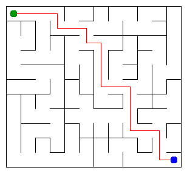

# Assignment 3. Maze Escape

Student ID: 250830
Name: Ali
Group: SE2532
Maze size (rows x columns): 11 x 12

## Program output

The 13 lines your program prints on your data (`java -cp out Main`):

    Broken: 131
    Kept: 110
    Last broken wall: 170
    MST cost: 40640
    Heaviest broken wall: 880
    Path length: 21
    DFS visited: 62
    Dead ends: 37
    Zones: 12
    Largest zone: 17
    Is DAG: 0
    Flow stages: 5
    Fastest route cost: 5

My maze:

## Questions
**Mission 0.** `find` gets the representative of the group containing a cell. `union` joins two different groups, putting the smaller one under the larger one. Path compression makes later searches shorter.

**Mission 1.** To connect N cells without a cycle, exactly N - 1 walls must be broken. The grid has R(C - 1) + C(R - 1) inner walls, so the number left is (R - 1)(C - 1).

**Mission 2.** My Kruskal MST cost is 40640, and Prim gives the same cost. Both select a minimum spanning tree, although they choose edges differently.

**Mission 3.** There is exactly one simple route between any pair of cells because the broken walls form a tree: connected, with no cycles. I used an array as an explicit DFS stack instead of recursive calls, so a large maze does not exhaust the call stack.

**Mission 4.** The first DFS sorts vertices by finish time. The second pass works on reversed edges to collect an entire strongly connected component without accidentally walking into the next component. A directed graph without self-loops has no cycles precisely when every SCC contains one vertex.

**Mission 5.** Kosaraju numbers the components in topological order, so every transition between different components goes from a smaller number to a larger number. Dynamic programming in that order handles each slide once, in O(n + m) time including the zone graph construction.

## Timing (Mission 7)

Milliseconds, 5 runs each, from `java -cp out Bench`.

| maze | Kruskal | Prim |
|---|---|---|
| 100 x 100 | 49 ms | 54 ms |
| 300 x 300 | 323 ms | 693 ms |
| 1000 x 1000 | not completed | not completed |

The run time increases as the maze grows because more cells and walls need to be processed. Both methods use a growing amount of work to manage candidate walls, with sorting in Kruskal and the priority queue in Prim. Measurements may vary by machine and JVM warm-up.

## Complexity

n is the number of cells, m the number of walls (or slides). Fill in every algorithm you wrote.

| algorithm | time | space | assumptions |
|---|---|---|---|
| DSU find and union | O(α(n)) amortized | O(n) for DSU arrays | union by size + path compression | |
| Kruskal | O(m log m) | O(n + m) | sort all wall costs | |
| Prim | O(m log m) | O(n + m) | binary priority queue over wall edges | |
| DFS | O(n + m) | O(n + m) | iterative, graph is a tree | |
| Kosaraju | O(n + m) | O(n + m) | iterative traversal of both graph directions | |
| Route in the zone graph | O(n + m) | O(z + m) | z is number of zones, already numbered topologically | |

- data/walls.txt, data/slides.txt and output/maze.png are in the repository.
- `java tools/Check.java` shows all examples right.
- This README is filled in, the program output and the section AI use included.
- The work is pushed to main (at least one commit per mission) and the repository is public.
- The link is attached in Moodle.
